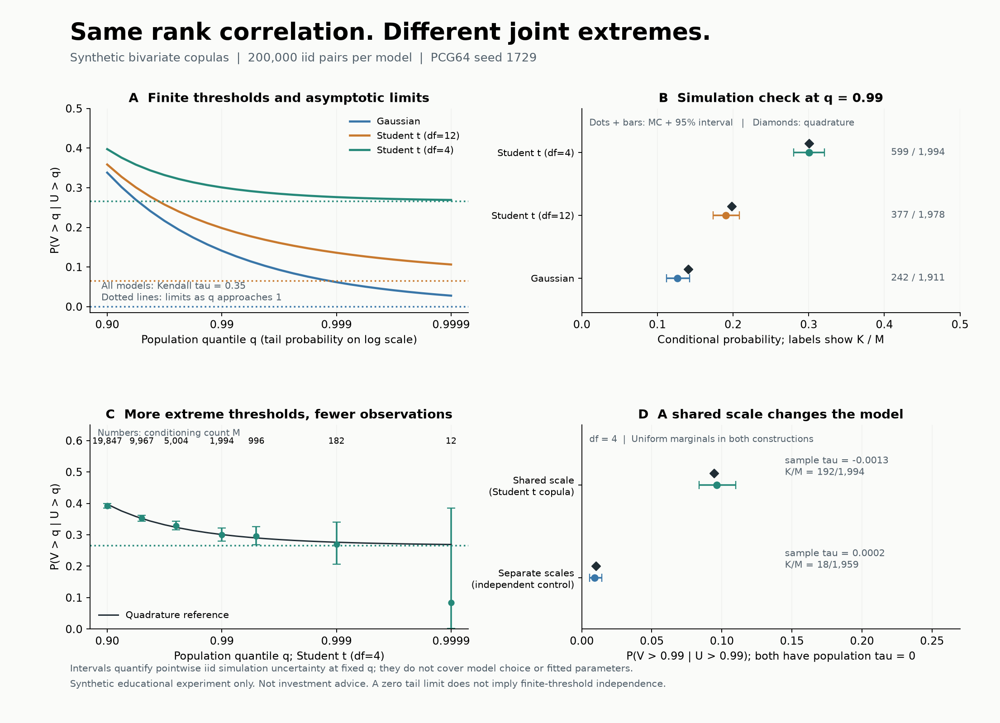

# Copula Tail Stress

[](https://github.com/lcx0731/copula-tail-stress/actions/workflows/ci.yml)

**How much can joint extremes change when rank correlation stays the same?**
This small Python project compares Gaussian and Student t copulas at matched
Kendall correlation. It combines seeded simulation, deterministic numerical
integration, and binomial uncertainty intervals. A separate-scale counterexample
shows why a seemingly harmless change to the t sampler changes its dependence.

All data are **deterministic seeded synthetic samples**. No market data, fitted
parameters, trading results, or personal research data are used. **Educational
only; not investment advice.**



## Reproduce

Python 3.11 or newer; CI exercises Python 3.11 and 3.13 on Linux. The saved
experiment was run with Python 3.13 and the pinned dependencies below.

```bash
git clone https://github.com/lcx0731/copula-tail-stress.git
cd copula-tail-stress
python3 -m venv .venv
source .venv/bin/activate
python -m pip install -r requirements.txt
python -m pip install --no-deps .
python -m pip check
python -m pytest -q
python examples/demo.py --output results
copula-tail-audit --family student --tau 0.35 --df 4 --q 0.99 --n 200000 --seed 1729
```

The example writes `results/metrics.json` and `results/tail_stress.png`.
`--output /tmp/copula-results` leaves the committed results untouched. The CLI
prints model settings, the numerical reference, observed counts, and both joint
and conditional intervals as JSON. Use `--family gaussian` without `--df` for
the Gaussian model. There is no data download or runtime network access.

## What is being measured?

For copula coordinates $(U,V)$ with uniform marginals, fix a **population**
quantile $q$ before generating data. The project distinguishes:

| Quantity | Meaning |
| --- | --- |
| $p(q)=P(U>q,V>q)$ | Joint exceedance probability |
| $\chi(q)=P(V>q\mid U>q)=p(q)/(1-q)$ | Conditional exceedance probability at a finite threshold |
| $\lambda_U=\lim_{q\uparrow1}\chi(q)$ | Asymptotic upper-tail dependence coefficient |

These are different targets. In particular, a Gaussian copula can have positive
finite-threshold joint dependence while its asymptotic coefficient is zero.
Monotone continuous marginal transforms preserve the copula, but this project
does not specify loss sizes or calculate portfolio loss, VaR, or returns.

### Sampling and matching

Both elliptical families use

$$\rho=\sin(\pi\tau/2),$$

where $\tau$ is population Kendall correlation. The main comparison fixes
$\tau=0.35$ and uses Gaussian, Student t with 12 degrees of freedom, and Student
t with 4 degrees of freedom. Matching Kendall correlation does **not** mean
matching Pearson correlation after arbitrary marginal transformations.

Two independent standard normals are transformed to a correlated pair
$(Z_1,Z_2)$ with correlation $\rho$. The Gaussian construction applies the
normal CDF. The Student construction draws one independent
$W\sim\chi^2_\nu$ **per pair**, forms

$$T_j=Z_j/\sqrt{W/\nu},\qquad U_j=F_\nu(T_j),$$

and shares that same $W$ between both coordinates. Different rows are iid.
The example uses NumPy PCG64, seed 1729, and 200,000 rows per model. Reusing a
seed couples the different model runs; their simulation errors are not
independent. No interval for a between-model difference is reported.

### Numerical reference and tail limit

The reference integrates a conditional survival probability over a uniform
tail coordinate. Let $F$ be the latent marginal CDF and $a=F^{-1}(q)$:

$$\chi(q)=\int_0^1 P\!\left(Y>a\mid X=F^{-1}\{q+(1-q)r\}\right)\,dr.$$

For the normal pair, the conditional law has mean $\rho x$ and variance
$1-\rho^2$. For the t pair it is a Student law with $\nu+1$ degrees of freedom,
location $\rho x$, and scale
$\sqrt{(\nu+x^2)(1-\rho^2)/(\nu+1)}$.
The implementation uses inverse survival probabilities instead of subtracting
tiny tail probabilities from one. Adaptive quadrature uses absolute tolerance
`5e-10` and relative tolerance `1e-9`. Its reported error estimate is a numerical
diagnostic, **not a certified bound**; convergence warnings raise an error.

For the supported nonsingular models, the Gaussian limit is zero and the
Student limit is

$$\lambda_U=2\,\overline F_{\nu+1}\!\left(\sqrt{\frac{(\nu+1)(1-\rho)}{1+\rho}}\right).$$

These formulas follow the elliptical copula construction in
[Demarta and McNeil (2005), *The t Copula and Related Copulas*](https://onlinelibrary.wiley.com/doi/10.1111/j.1751-5823.2005.tb00254.x).
The implementation and experiments here were written for this repository.

### Monte Carlo uncertainty

For $n$ iid pairs, let $M$ count $U>q$ and $K$ count both $U>q$ and $V>q$.
The conditional estimate is $K/M$. Given $M$, its numerator is binomial with
success probability $\chi(q)$, so the interval uses $M$ trials, **not $n$**.
The joint estimate is $K/n$ with a separate $n$-trial binomial interval.

Both intervals are equal-tailed 95% Clopper–Pearson intervals obtained from beta
quantiles. Their binomial coverage is conservative; “exact” refers to the
binomial construction, not exact floating-point arithmetic. With $M=0$, the
conditional estimate is `null` and its interval is `[0,1]`. With $K=0$ and
$M>0$, the upper endpoint remains positive. Exceedances use strict `>`.

Intervals are **pointwise**: they do not form a simultaneous band across
thresholds and models. They quantify simulation uncertainty for a fixed model
and threshold, not uncertainty in fitted parameters, model choice, empirical
quantiles, or the limit $\lambda_U$. Selecting a threshold using the same sample
or using serially dependent observations would require a different analysis.

## Saved results

Values below come from the committed [metrics](results/metrics.json), rounded
for readability. At $q=0.99$, all three models have population $\tau=0.35$:

| Model | Sample Kendall tau | Reference $\chi(0.99)$ | MC estimate | 95% conditional interval | $K/M$ | Limit $\lambda_U$ |
| --- | ---: | ---: | ---: | ---: | ---: | ---: |
| Gaussian | 0.35039 | 0.14100 | 0.12664 | [0.11204, 0.14238] | 242 / 1911 | 0 |
| Student t, df=12 | 0.35046 | 0.19825 | 0.19060 | [0.17350, 0.20861] | 377 / 1978 | 0.06458 |
| Student t, df=4 | 0.34913 | 0.30075 | 0.30040 | [0.28033, 0.32106] | 599 / 1994 | 0.26586 |

The reference conditional probability is about 2.13 times as large for t(4)
as for the Gaussian model at this threshold. This is a comparison between the
specified synthetic models, not an empirical financial risk estimate.

At $q=0.9999$, the t(4) run has only **12 conditioning observations and one
joint exceedance**. Its estimate is 0.08333, the reference is 0.26911, and the
interval is [0.00211, 0.38480]. The same 200,000-row simulation therefore gives
a very imprecise estimate in the far tail. This result is retained rather than
changing the seed to obtain a closer point estimate. The largest reported
quadrature error estimate across the plotted curves is below `4.81e-10`, which
does not account for all numerical error.

### Why the shared scale matters

The negative control fixes $\rho=\tau=0$ and df=4. It compares a correct
Student copula with independent normal coordinates sharing one chi-square
scale against independent normal coordinates with **separate** scales.
Both have uniform marginals and zero population Kendall correlation, but the
separate-scale construction has independent coordinates and is not that t
copula.

| Construction | Sample Kendall tau | Reference $\chi(0.99)$ | MC estimate | 95% interval |
| --- | ---: | ---: | ---: | ---: |
| Shared scale: t copula | -0.00126 | 0.09458 | 0.09629 | [0.08369, 0.11009] |
| Separate scales: independent control | 0.00024 | 0.01000 | 0.00919 | [0.00545, 0.01448] |

Checking only marginal uniformity and Kendall correlation would miss this
sampling error. The shared-scale model also has a positive asymptotic
coefficient, 0.07559, despite zero rank correlation.

## Validation and layout

The 49 tests cover:

- Numerical references against the exact elliptic median-quadrant identity,
  Gaussian independence, a closed-form t tail-limit anchor, and integration
  in an alternative latent coordinate.
- Beta-quantile intervals against SciPy's independent binomial-tail inversion;
  finite binomial enumeration checks coverage, including a random conditioning
  count and the zero-observation convention.
- Seeded sampler marginal, rank, and joint-tail checks; a separate-scale
  counterexample; strict threshold boundaries, invalid input, reproducibility,
  and the installed CLI from outside the source directory.

Stochastic sanity tests use broad prespecified tolerances. Tests do not require
every 95% interval in a multi-threshold experiment to contain its reference.
The Actions workflow installs the package, runs all tests, and regenerates the
full example on both Python versions.

| Path | Purpose |
| --- | --- |
| `src/copula_stress/core.py` | Copula sampler, quadrature reference, intervals |
| `src/copula_stress/diagnostics.py` | Independent-scale negative control |
| `src/copula_stress/cli.py` | Single-model JSON audit |
| `examples/demo.py` | Matched-rank comparison, controls, figure and metrics |
| `tests/` | Independent references and edge cases |
| `results/` | Reproducible synthetic outputs |

The implementation deliberately supports only two dimensions, Kendall tau in
`[-0.8,0.8]`, Student df in `[3,200]`, quantiles in `[0.5,0.9999]`, and sample
counts up to one million. API scalars use built-in Python `int`/`float` types.
It does not fit copulas, select a family, support time dependence, handle
discrete marginal ties, or infer tail behavior from observed financial data.
Numerical CDFs and quadrature use floating-point arithmetic; bitwise identity
across platforms or library versions is not promised. The two families are
symmetric in upper and lower tails and cannot represent all asymmetric risks.

Dependency documentation:
[SciPy binomtest](https://docs.scipy.org/doc/scipy/reference/generated/scipy.stats.binomtest.html),
[SciPy beta distribution](https://docs.scipy.org/doc/scipy/reference/generated/scipy.stats.beta.html).
Released under the [MIT License](LICENSE).
